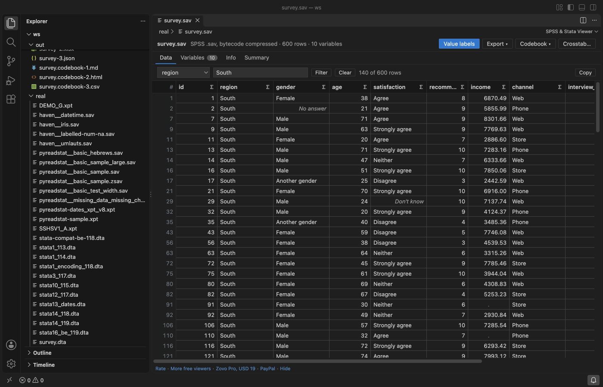
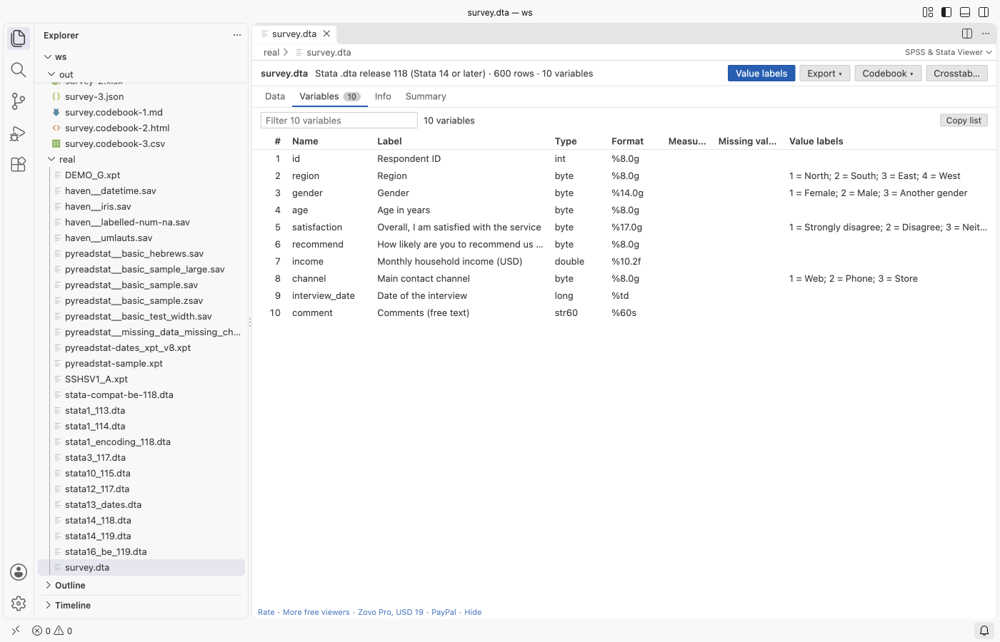
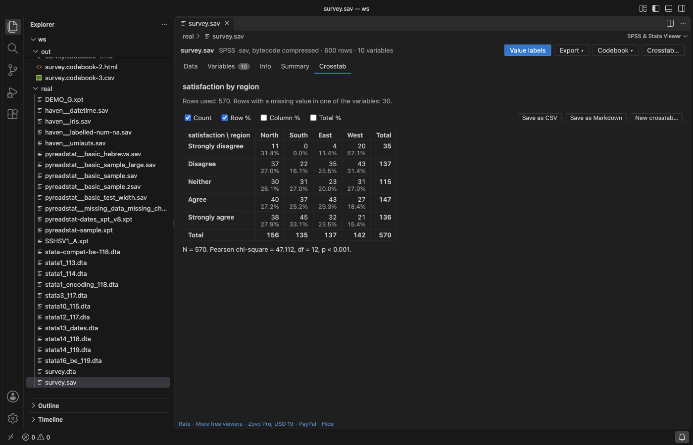

# SPSS Viewer & Stata Viewer for VS Code (SAV, DTA, XPT Files)

Zovo Pro: USD 19 once, every Zovo tool. Export, Codebook and Crosstab are Pro, with 3 free tries each; viewing data stays free.

Open SPSS `.sav` and `.zsav`, Stata `.dta` and SAS transport `.xpt` data files in a VS Code tab, without SPSS, Stata or SAS installed. See the data in a fast grid with value labels, variable labels, missing values and dates, then sort, filter, summarize and copy. Read-only, no network, millions of rows.

## What you get for free

- **Data grid.** Rows load a page at a time from a reader in the background, so a file with millions of rows scrolls at once. Click a column header to sort; click again for descending.
- **Value labels or codes.** One button switches between "Strongly agree" and the code `5` behind it, in the grid and in the copied text.
- **Variables tab.** Name, label, type, display format, measure (nominal, ordinal, scale), user-defined missing values and value labels of every variable, with a filter box.
- **Missing values.** The system missing value shows as a grey dot. SPSS user-defined missing values (discrete values and ranges) and Stata `.a` to `.z` show in grey italics and are left out of the statistics.
- **Dates.** SPSS `DATE`, `ADATE`, `EDATE`, `SDATE`, `DATETIME`, `TIME` and `DTIME`, Stata `%td`, `%tc`, `%tw`, `%tm`, `%tq`, `%th` and `%ty`, and SAS `DATE`, `DATETIME` and `TIME` formats show as dates and times.
- **Filter.** Pick a column and type text, a comparison (`> 30`, `<= 5`, `!= 9`), a range (`18..65`) or `missing`.
- **Summary.** The **Σ** in a column header shows valid and missing counts, mean, standard deviation, minimum, quartiles, median, maximum and the most frequent values. Variables with value labels get a frequency table with percent, valid percent and cumulative percent.
- **Copy.** Click a cell, shift-click another, and press Ctrl+C (Cmd+C on a Mac): the range goes to the clipboard as tab-separated text with the variable names, ready to paste into Excel or a document.
- **Info tab.** Rows, variables, file label, creation date, encoding, compression, the program that wrote the file, the weight variable and the documents stored in the file.

## Zovo Pro tools

Three tools for analysts and researchers, in the toolbar of the viewer and the Command Palette. Each has 3 free tries on your computer; a try counts only when the file is written or the crosstab is on screen. Escape or Cancel never uses a try.

- **Export data** to CSV, Excel (`.xlsx`) or JSON, with value labels or with codes. The export takes the rows in the current view, so a filter and a sort apply. The Excel file has a second sheet with the variables and their value labels.
- **Codebook** as Markdown, HTML or CSV: every variable with its label, type, format, measure, missing value definitions, value labels with counts and percentages, and summary statistics. Useful for a data appendix, a data management plan or a quick check before analysis.
- **Crosstab** of two variables, with an optional third as a layer: counts, row, column and total percentages, and a Pearson chi-square test with degrees of freedom, p-value and a note when expected counts are below 5. Save the table as CSV or Markdown.

Zovo Pro is USD 19 once and turns on the Pro tools of every Zovo extension. When the free tries are used, the tool shows the ways to pay: by card, GitHub Sponsors or PayPal, or enter a key you already have. Nothing about Pro shows when you open a file. The setting `statsViewer.showProTools` hides the three buttons.

## Supported files

| Format | Files | Read |
|---|---|---|
| SPSS system file | `.sav` (uncompressed and bytecode compressed), `.zsav` (zlib) | Variables, long names, labels, value labels (also for long strings), user-defined missing values, very long strings (over 255 characters), measure levels, the encoding record, documents, the weight variable |
| Stata | `.dta` releases 113, 114, 115 (Stata 8 to 12), 117 (Stata 13), 118 and 119 (Stata 14 to 18) | Variables, labels, value labels, `strL` long strings, extended missing values `.a` to `.z`, display formats and dates, either byte order |
| SAS transport | `.xpt` version 5 (the format of FDA submissions) | Variables, labels, formats, IBM floating point numbers, missing values `.A` to `.Z` and `._`. A file with several datasets shows the first one |

Not read: SAS `.sas7bdat` files, SPSS portable `.por` files and SAS transport version 8.

## Open a file

- Click a `.sav`, `.zsav`, `.dta` or `.xpt` file in the Explorer. It opens in the viewer.
- Or run **SPSS & Stata Viewer: Open in SPSS & Stata Viewer** from the Command Palette.
- Run **SPSS & Stata Viewer: Get started** for a short walkthrough with sample files.

## Safe with any file

- The file is read in a separate worker thread with a memory limit and a time limit. A damaged or hostile file shows a message, and the editor keeps working.
- Every count in the file is checked against the file size before memory is used. A file cut short shows the rows that were complete.
- Names, labels and values are shown as plain text, never as HTML. The viewer page has a strict content security policy and loads nothing from the internet.
- The viewer never writes to your data file.

## Commands

| Command | What it does |
|---|---|
| SPSS & Stata Viewer: Open in SPSS & Stata Viewer | Open a data file in the viewer |
| SPSS & Stata Viewer: Open a sample SPSS file | Open the bundled sample survey |
| SPSS & Stata Viewer: Export data to CSV, Excel or JSON (Pro) | Export the current view |
| SPSS & Stata Viewer: Write a codebook (Pro) | Codebook as Markdown, HTML or CSV |
| SPSS & Stata Viewer: Crosstab with chi-square (Pro) | Crosstab two variables |

## Settings

| Setting | Default | What it does |
|---|---|---|
| `statsViewer.showProTools` | `true` | Show the Export, Codebook and Crosstab buttons |
| `statsViewer.showSupportLinks` | `true` | Show the small links at the bottom of the viewer |
| `statsViewer.askForRating` | `true` | Ask once, after a few days of use, whether you want to rate the extension |

## Limits

- Up to 40 million cells (for example 2 million rows of 20 variables) and 200 million characters of text are read; a larger file shows the first rows and says so on the Info tab.
- Excel export stops at Excel's limit of 1,048,575 rows; CSV has no such limit.
- A crosstab takes variables with up to 200 categories, and up to 50 layers.

## Privacy

No network requests and no telemetry. The files you open stay on your computer.

## Support Zovo

Zovo Pro: USD 19 once, every Zovo viewer. [Get Zovo Pro on GitHub Sponsors](https://github.com/sponsors/theluckystrike/sponsorships?tier_id=679878) to turn on the Pro tools in this extension and in the other Zovo extensions you use. The free features stay free.

Zovo extensions have no ads and no tracking. They are made by [theluckystrike](https://github.com/theluckystrike) on GitHub. You can also support the work with no Pro:

- [Sponsor on GitHub](https://github.com/sponsors/theluckystrike)
- [PayPal](https://www.paypal.com/paypalme/najzzz)
- [Follow theluckystrike on GitHub](https://github.com/theluckystrike)

### Need your format supported?

Open a [format request](https://github.com/theluckystrike/spss-stata-viewer-vscode/issues/new?template=format-request.yml) with a sample file, and I reply there whether it can be done. For USD 299 once, through [this GitHub Sponsors tier](https://github.com/sponsors/theluckystrike/sponsorships?tier_id=679995), I add your file format or a missing feature to this extension, with tests, within 7 days.

## More tools by Zovo

- [XLSX Viewer, Excel Viewer, CSV Viewer & Parquet Viewer (XLS, CSV Preview)](https://marketplace.visualstudio.com/items?itemName=zovo.table-viewer-vscode) opens CSV, TSV, Excel and Parquet files as a sortable, filterable table.
- [SQLite Editor & Viewer, SQLite3 Database Browser (Edit Cells, CSV Import)](https://marketplace.visualstudio.com/items?itemName=zovo.sqlite-table-viewer) browses SQLite tables read-only and runs SELECT queries.
- [MongoDB Client & MongoDB GUI: Query, Edit Documents, Aggregation & Indexes](https://marketplace.visualstudio.com/items?itemName=zovo.zovo-mongodb-client) queries and edits MongoDB documents in a grid or as JSON.
- [Oracle SQL & SQL Server Query Client (MSSQL, T-SQL, PLSQL, Oracle Database Tool)](https://marketplace.visualstudio.com/items?itemName=zovo.zovo-oracle-sqlserver-client) runs Oracle SQL and T-SQL and browses tables.
- [Postgres & MySQL Query Client - SQL Database Tool (SQLite, CSV Export)](https://marketplace.visualstudio.com/items?itemName=zovo.zovo-sql-client) runs Postgres and MySQL queries, edits rows and exports CSV.

See [all Zovo extensions on the Marketplace](https://marketplace.visualstudio.com/publishers/zovo).
